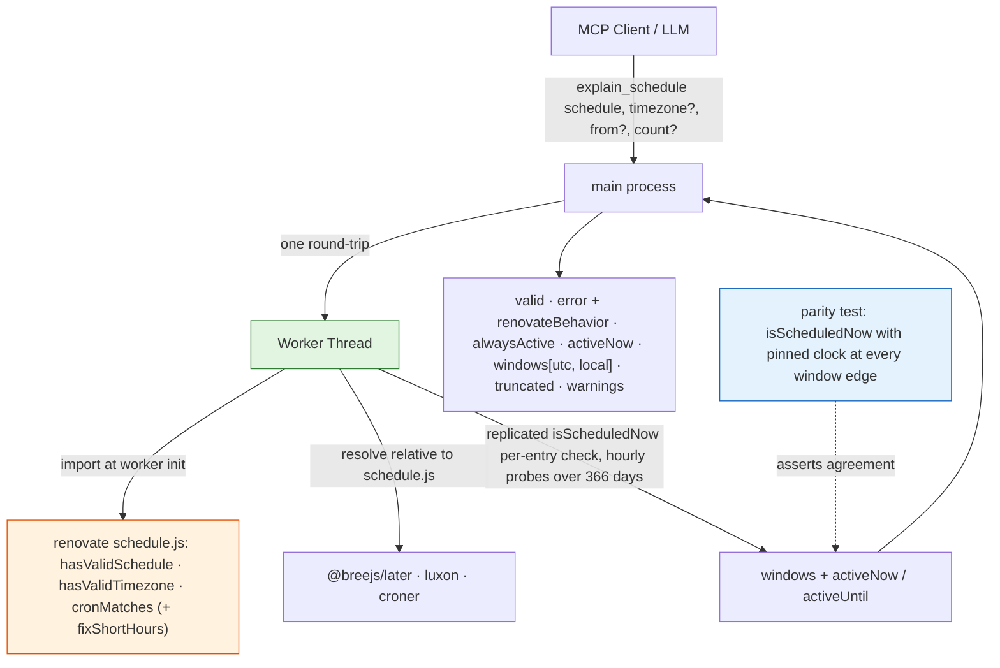

# 0007. Worker-isolated faithful schedule windows for `explain_schedule`

**Date:** 2026-10-27

**Status:** Accepted

## Context

Schedules are one of the most common things people get wrong in a Renovate config: later-text like `before 4am on Monday` with a missing or wrong `timezone`, cron with the wrong field order, or a `schedule` inside a `packageRules` entry that never fires when expected. `lint_config`'s `invalid-schedule` rule only answers "does this parse?". Nothing answers "when will this actually run?" — [#417](https://github.com/tibuntu/renovate-mcp/issues/417).

**`explain_schedule`** takes a `schedule` (string or array, the config option's own shape), an optional `timezone` and an optional `from` instant, and returns whether the schedule is active at `from` plus the next N run windows as ISO timestamps in both UTC and the timezone. It hits the same two-constraint collision as ADR-0001 / 0004 / 0006.

**Constraint 1 — the "no `renovate` import in `src/`" rule.** `CLAUDE.md` forbids importing `renovate` as a library from the main server process.

**Constraint 2 — faithful evaluation has no CLI surface and no injectable clock.** Reading `renovate@44.181.5`'s `dist/workers/repository/update/branch/schedule.js`:

1. The module exports `hasValidSchedule`, `hasValidTimezone`, `cronMatches(cron, now, timezone)` and `isScheduledNow(config)`. Only the first three take their inputs as arguments; **`isScheduledNow` reads `DateTime.local()`** and can only answer "is it active *right now*?".
2. Text schedules are parsed by `@breejs/later` after two Renovate-specific rewrites — a private two-entry `scheduleMappings` table (`every month` / `monthly`) and `fixShortHours` from `dist/config/migration.js` — and matched by handing `later` the **zone-local wall time re-labelled as UTC**. Cron entries are detected with `croner`'s `CronPattern` and matched by `cronMatches`.
3. Renovate forbids minutes in both forms (`* ` minutes for cron, no `m` constraint for text), so every schedule is hour-granular.

There is a decisive fidelity subtlety: an **invalid** schedule or timezone does not disable updates — `isScheduledNow` logs a warning and returns `true`, i.e. Renovate runs *at any time*. A tool that merely said "invalid" would hide the actual consequence.

## Considered Options

### Option 1: Reimplement the parser offline in `src/`

Port `later`'s text grammar (or a subset) and cron matching into our own code.

**Cons:** a large hand-maintained reimplementation of exactly the surface the "no `renovate` import" rule exists to decouple us from, with the worst failure mode — confidently-wrong windows. Rejected, as in ADR-0004 / 0006.

### Option 2: Depend on `@breejs/later` directly and skip Renovate's module

Add `@breejs/later` + `croner` + `luxon` as direct dependencies and evaluate without touching `renovate` — the issue's own "later-only" variant.

**Cons:** we would still have to copy `hasValidSchedule`'s validity rules, the `scheduleMappings` table, `fixShortHours`, the cron-vs-text detection and the wall-time-as-UTC trick — every one of which can drift on a Renovate bump without any test noticing, because nothing would compare against Renovate itself. Three new pinned dependencies for a strictly less faithful result.

### Option 3: Call `isScheduledNow` in a worker with a pinned clock

Override luxon's `Settings.now` (or the process clock) and call `isScheduledNow` per probe — zero replication.

**Cons:** `Settings.now` only works if our `luxon` import is the *same module instance* as the one Renovate's ESM build loaded, which depends on npm hoisting; a silent mismatch would make the tool return windows for the real clock with no error. It also re-validates and re-parses every entry on every one of up to 8,784 probes and emits a logger line per probe.

### Option 4: Worker-isolated real validators/matchers + loop replication (chosen)

A dedicated worker imports Renovate's real `hasValidSchedule` / `hasValidTimezone` / `cronMatches` / `fixShortHours`, resolves `@breejs/later`, `luxon` and `croner` **relative to Renovate's own schedule module** (so it uses exactly the copies Renovate would, with no new direct dependencies), and **replicates the per-entry check inside `isScheduledNow`** with an injectable instant. It probes every local hour over a 366-day horizon and groups hits into windows. The `scheduleMappings` table is the only copied data (two entries, reconciled against the pinned Renovate version). A parity-oracle test runs Renovate's real `isScheduledNow` with a pinned clock at every window edge the worker reports and asserts agreement.

**Pros:**
- The only option that is faithful *and* guarded: the parser, validator and matcher are Renovate's, and the small replicated loop is pinned by an oracle that calls the very function it replicates.
- Reuses the ADR-0001 / 0004 / 0006 worker pattern unchanged (terminable, stdio-isolated, single round-trip, shared 30 s budget via `runRenovateWorker`).
- Hourly probing is exact, not an approximation, because Renovate itself forbids sub-hour schedules.

**Cons:**
- A **fourth** worker-isolated `renovate` import; the per-entry check is version-coupled to the installed Renovate.
- No preview fallback is possible: nothing outside the worker can evaluate a later-text schedule, so a worker failure is an `isError` rather than a degraded result.

## Decision

**We will use Option 4.** New worker pair `src/lib/scheduleWorker.ts` + `src/lib/scheduleWorkerImpl.ts`, mirroring `mergeWorker` / `packageRulesWorker`, driven through the shared `runRenovateWorker`. It is a **new dedicated worker**, not an extension of an existing one — schedule evaluation is orthogonal to merging and rule matching.

Deciding factors:

1. **Faithfulness is structurally guaranteed and tested.** Validity messages are Renovate's verbatim; windows come from Renovate's matcher; the replication is pinned against `isScheduledNow` by the oracle, and a Renovate bump that changes the module's exports fails the import loudly in PR CI.
2. **Honest about the consequence of invalidity.** The tool returns `valid: false` with Renovate's message *and* `renovateBehavior` stating that Renovate then runs at any time — the footgun the tool exists to surface — rather than an `isError`.
3. **Deterministic without a `timezone`.** The tool evaluates in UTC when none is given and says so (`timezoneAssumed`), matching what Renovate does on a UTC runner and what the `schedule-without-timezone` lint rule already tells users.
4. **Bounded cost.** One cold start per call; the scan stops at `count` windows; a full-horizon walk of a never-firing schedule stays well under 5 s.

This narrows the carve-out further: a **fourth** worker-isolated `renovate` import now exists. The rule survives in substance; any future such tool still needs its own ADR.

## Consequences

**Easier:**
- Users get "when will this run?" answers that agree with Renovate, including the three classic mistakes: a schedule meant in local time but evaluated in UTC, cron in the wrong form, and an `after … and before …` entry that the parser ANDs into something that never fires (reported as zero windows plus a warning).

**Harder:**
- Schedule semantics are version-coupled to the installed Renovate. Mitigated by the **parity oracle** (`test/unit/scheduleWorker.test.ts`), the import of named exports (a rename fails loudly), the `scheduleMappings` reconciliation note in the worker, and the nightly real-Renovate workflow.
- `isScheduledNow`'s quirks are reproduced on purpose — the `at any time` short-circuit inspects only the first entry; `every month` expands to `before 5am on the first day of the month` — and documented in `docs/tools.md` rather than "fixed".

**Tradeoffs accepted:**
- Further rule-erosion: a fourth worker-isolated import.
- No approximate fallback; a worker problem hard-fails the call, unlike the merge and packageRules tools.
- Sub-hour timezone offsets with a sub-hour DST shift (Lord Howe Island) can place probes off the local hour after a transition; the window edges stay correct to the probe, which is the ceiling of hourly probing.

**Follow-ups (completed with this decision):**
- `src/lib/scheduleWorker.ts` + `src/lib/scheduleWorkerImpl.ts` (worker + protocol); shim for `dist/workers/repository/update/branch/schedule.js` in `src/types/renovate-shims.d.ts`.
- `src/tools/explainSchedule.ts`, wired in `src/index.ts` + `BASE_INSTRUCTIONS`; `EXPLAIN_SCHEDULE_FAITHFUL_DISCLAIMER` in `src/lib/toolInputs.ts`.
- `vitest.config.ts` gains `RENOVATE_MCP_SCHEDULE_WORKER_ENTRY`; unit tests with the parity oracle, stdio integration tests, tool-count sentinels bumped to 18.
- `CLAUDE.md` Architecture carve-out amended; docs (`docs/tools.md`, `docs/architecture.md`, `docs/operations.md`, `docs/security.md`, `docs/development.md`, `docs/roadmap.md`, `README.md`) updated.

## Diagram

