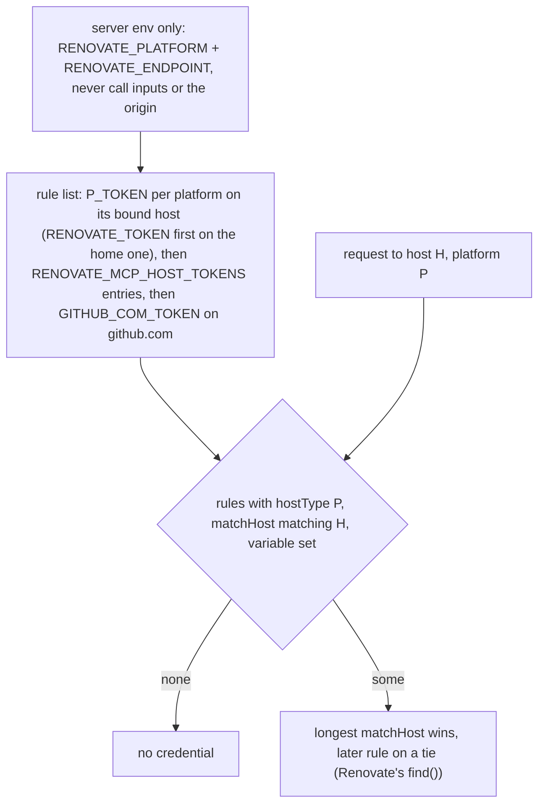

# 0008. Host-scoped credentials and `local>`-only endpoint routing

**Date:** 2026-11-10

**Status:** Accepted

## Context

Until now one rule picked the credential for every outbound preset fetch: `RENOVATE_TOKEN` if set, else the fetched platform's own variable (`GITHUB_TOKEN`, `GITLAB_TOKEN`, `GITEA_TOKEN`, `FORGEJO_TOKEN`, `BITBUCKET_TOKEN`). A second rule picked the host: the `endpoint` input replaced the API base for **every** source, so `github>` went to a GitHub Enterprise endpoint and `gitlab>` to a self-hosted GitLab.

Both rules differ from Renovate, and the first one sends credentials to the wrong host:

1. **`RENOVATE_TOKEN` went everywhere.** It is Renovate's *platform* token, valid for one host. A user whose `RENOVATE_TOKEN` is a self-hosted GitLab token sent it to gitlab.com, api.github.com, gitea.com and api.bitbucket.org whenever a config extended a preset there. `GITLAB_TOKEN` likewise went to whatever `endpoint` a call named.
2. **`endpoint` rerouted sources Renovate never reroutes.** Renovate hard-codes the public API for `github>` (`lib/config/presets/github/index.ts`), `gitlab>` (`gitlab/index.ts`), `gitea>` and `forgejo>`. Only `local>` resolves through the configured platform and endpoint (`lib/config/presets/local/index.ts`), at any nesting depth. So a config that resolved here could fail under Renovate, and the reverse.
3. **No way to name a token for a third host.** A second self-hosted GitLab, or a GitLab next to a GitHub Enterprise, had no credential at all.
4. **Whoever names the host gets the token.** The host a request goes to can come from a tool call (`platform`, `endpoint`, `dry_run`'s `presetPlatform`) or from the repository (the origin remote in `.git/config`, from which `dry_run` derives the `local>` route). A tool call can be steered by a prompt injection, and a repository can be untrusted. If the host that routing picks also decided which token goes along, either could send `RENOVATE_TOKEN` or `GITLAB_TOKEN` to a host of its choosing.

`dry_run` adds one more case. It spawns Renovate, which reads `RENOVATE_TOKEN` as the platform token and deletes `GITHUB_TOKEN` / `GITLAB_TOKEN` / `BITBUCKET_TOKEN` from its environment. Tokens for other hosts have to reach it as `hostRules`, and an operator may already point it at their own config file with `RENOVATE_CONFIG_FILE`.

## Considered Options

### Option A: Keep `RENOVATE_TOKEN` first, document the risk

**Cons:** keeps a credential leak as the default. The safe setup would be the one users have to discover.

### Option B: Bind every token to a host

Each per-platform token goes only to its platform's host: the public host (github.com, gitlab.com, gitea.com, code.forgejo.org, bitbucket.org, subdomains included), or the home endpoint's host when the home platform is that platform. `RENOVATE_TOKEN` goes only to the home host. `GITHUB_COM_TOKEN` keeps its Renovate meaning, github.com only. The *home* comes from the server env only: `RENOVATE_PLATFORM`, at `RENOVATE_ENDPOINT`. Without a hosted `RENOVATE_PLATFORM` there is no home.

**Pros:** no request carries another platform's token. Matches how Renovate scopes its own platform token.

**Cons:** breaking. A setup that relied on one `RENOVATE_TOKEN` for several platforms loses auth on all but the home one, and a per-platform token now wins over `RENOVATE_TOKEN` where both apply.

### Option C: B plus host tokens by reference

B, plus `RENOVATE_MCP_HOST_TOKENS`: a JSON array of `{matchHost, hostType, tokenEnv}` entries. `tokenEnv` names another env var, so the variable holds no secret and can be logged or shown by `check_setup`. Matching follows Renovate's `matchesHost`: a bare host matches itself and its subdomains, an `https://` URL is a prefix.

**Pros:** covers the third-host case without a value-bearing variable.

**Cons:** one more variable to validate. A half-valid value is worse than none, so one bad entry rejects the whole variable.

## Decision

**We will use Option C, and route only `local>` through `endpoint`.**

Tokens become one ordered host rule list, the one `dry_run` writes for Renovate:

1. one rule per hosted platform P: `
_TOKEN` on P's bound bare host; on the home platform's rule `RENOVATE_TOKEN` comes first and `
_TOKEN` is the fallback, because Renovate itself uses `RENOVATE_TOKEN` for its platform rule and deletes `GITLAB_TOKEN` and friends from its env;
2. one rule per `RENOVATE_MCP_HOST_TOKENS` entry;
3. `GITHUB_COM_TOKEN` as `{hostType: github, matchHost: github.com}`, which Renovate itself appends from env after the file config's rules.

The token for a request to host H of platform P is what Renovate's `hostRules.find()` returns over that list: among the rules with hostType P whose `matchHost` matches H and whose variable is set, the longest raw `matchHost` wins, then the later rule. Every rule here carries a hostType and a matchHost, so Renovate's rank (hostType + matchHost over matchHost alone) never separates them. The fetcher and the spawned Renovate therefore cannot pick different tokens for the same request.

Routing: `github>` / `gitlab>` / `gitea>` / `forgejo>` always use their public API. `local>` uses the effective platform and endpoint, and so does a `local>` inside a fetched preset. This is the second breaking change, and it affects every tool with an `endpoint` input in the `resolve_config` family.

**Routing and token binding are separate.** The `local>` route is computed by `homeScope(input, env)` in `src/lib/hostTokens.ts`: platform = the `platform` input, else `RENOVATE_PLATFORM` (hosted platforms only); endpoint = the `endpoint` input, else `RENOVATE_ENDPOINT`, but the env endpoint only when there is no `platform` input or it equals `RENOVATE_PLATFORM` (an env endpoint belongs to the env platform). `dry_run` uses the same route: on a remote run the effective endpoint is passed as `--endpoint`, and an ignored `RENOVATE_ENDPOINT` is removed from the child's environment; in local mode `presetPlatform`, else the origin's platform, takes the place of the `platform` input.

The token binding never reads that route. It reads only the env scope, `RENOVATE_PLATFORM` + `RENOVATE_ENDPOINT`, and the platforms' public hosts; `selectToken` and `buildHostTokenRules` take no scope argument, so no caller can pass one in. A `platform`, `endpoint` or `presetPlatform` on a call, or a platform derived from the origin, never moves an env token to another host (context item 4). A host that only the call or the repository names gets a token only through a `RENOVATE_MCP_HOST_TOKENS` entry, which the operator wrote, or through `dry_run`'s `token` / per-call `hostRules` inputs, which carry their own secret. Examples: with `platform: "gitlab"` on the call and `RENOVATE_PLATFORM=github` plus a GitHub Enterprise `RENOVATE_ENDPOINT`, the call routes `local>` to gitlab.com, which gets `GITLAB_TOKEN` (its public host) but never the GHE `RENOVATE_TOKEN`; with `endpoint: "https://gitlab.attacker.example/api/v4"` on the call, the presets go there without any env token.

Validation of `RENOVATE_MCP_HOST_TOKENS`: exactly the three keys, non-empty strings, `tokenEnv` a variable name, `hostType` lowercase, `matchHost` a lowercase bare host or a credential-free `https://` URL, at most 256 entries. Any failure rejects the variable. Every fetch-enabled call then returns `isError` before a request is made, and the message names the entry index and field, never the value. An entry whose referenced variable is unset is skipped.

`dry_run` writes rules 1 and 2 of that list into its temporary Renovate config as `hostRules`, followed by the per-call `hostRules`, so per-call rules win ties. `GITHUB_COM_TOKEN` stays a native env var: Renovate appends its rule itself, at the same position the fetcher models. Rules that a later rule for the same `hostType` and `matchHost` replaces anyway are left out, so their tokens are not written to disk: the platform rule of a remote run and per-call rules carrying a credential. On a remote run the platform token exported as `RENOVATE_TOKEN` is the `token` input, else the list's pick for the API host without `GITHUB_COM_TOKEN` (Renovate's platform rule is appended last and beats it there); no pick is an error before spawning. Renovate's platform rule sits on the API host itself (api.github.com for github.com), so the run platform's env rule on a parent domain of it (github.com) is left out too, as is any rule on the API host. Under `platform=local` the child gets no `RENOVATE_TOKEN` at all; Renovate's platform rule would have hostType `local` and no host. The env home's rule still reaches it as a host rule.

When the operator has set `RENOVATE_CONFIG_FILE`, `dry_run` leaves that file alone and passes its rules through `RENOVATE_ADDITIONAL_CONFIG_FILE`, which Renovate merges after the file config with `hostRules` concatenated. Only when the operator has set both does it skip the automatic rules with a warning and refuse per-call `hostRules`.

## Consequences

**Easier:**
- A token can only reach the host it was issued for. Mixed setups (GitHub Enterprise plus gitlab.com, two GitLabs) get a credential per host.
- Preset routing in the `resolve_config` family matches Renovate, so a config that resolves here resolves the same way in a real run.

**Harder:**
- Breaking for users who set one `RENOVATE_TOKEN` for several platforms, or who used `endpoint` to reroute `github>` / `gitlab>` presets. Such presets have to be written as `local>` with `platform` + `endpoint`. Auth failures name the variables tried, or say that no token is bound to the host, so the cause is visible.
- Breaking for users who pass a self-hosted `platform` + `endpoint` per call and relied on the env token following it: they set `RENOVATE_PLATFORM` / `RENOVATE_ENDPOINT` on the server, or add a `RENOVATE_MCP_HOST_TOKENS` entry for the host. Likewise a user with only `RENOVATE_TOKEN` who passes `platform` per call must set `RENOVATE_PLATFORM`.
- `check_setup` hints have to explain the home platform, because `RENOVATE_TOKEN` now depends on it.

**Tradeoffs accepted:**
- Without `RENOVATE_PLATFORM` there is no home, unlike Renovate, which defaults to github. Guessing github would send a `RENOVATE_TOKEN` meant for another platform to api.github.com. A user with only `RENOVATE_TOKEN` must now set `RENOVATE_PLATFORM`, or use the per-platform variable.
- On the env home with a self-hosted `RENOVATE_ENDPOINT`, the home platform's own token is bound there as the fallback and not to its public host, so a `GITLAB_TOKEN` issued for that GitLab never reaches gitlab.com.
- `dry_run` now writes the env tokens into its temporary host-rules file on most runs, not only on runs with per-call `hostRules`; the file is removed in a `finally` block, but a server killed hard (SIGKILL, power loss) leaves it in the temp directory, readable only by the server's user.
- The rate-limit hints still name `GITHUB_TOKEN` / `GITLAB_TOKEN`, which is right for the public hosts and only approximate when an endpoint moves the binding.

**Follow-ups:**
- With this decision: `src/lib/hostTokens.ts` (pure selection, parsing, host-rule building), the fetcher and resolver switched to it, `hostTokensError` in `src/lib/toolInputs.ts`, `dry_run` token export and host-rule generation, tool descriptions, `check_setup` hints, docs.
- Separately: `check_setup` reporting of host-token entries by name and presence.

## Diagram

