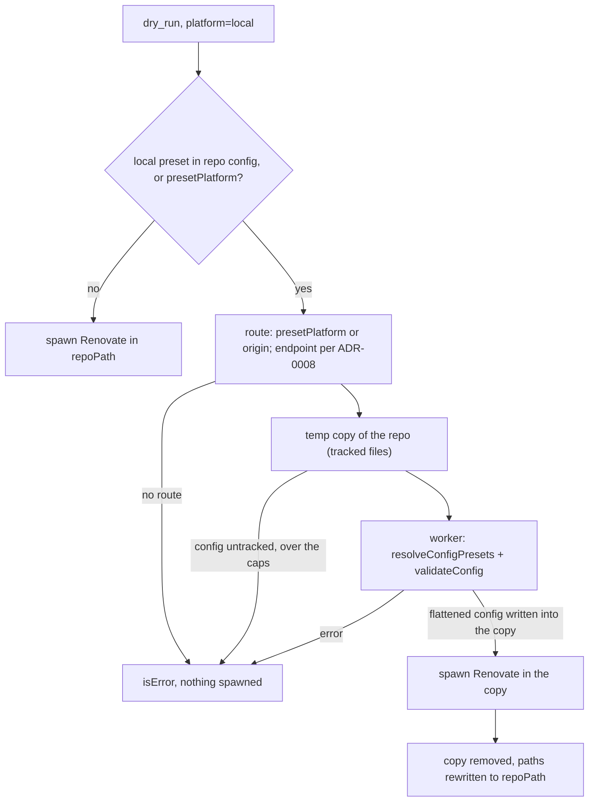

# 0009. Worker-isolated `local>` preset flattening for `dry_run` in local mode

**Date:** 2026-11-10

**Status:** Accepted

## Context

`dry_run` runs Renovate with `--platform=local` by default. Renovate's `local` platform cannot resolve `local>` presets: `lib/config/presets/local/index.ts` looks up a resolver for the global `platform`, finds none for `local`, and throws "The platform you're using (local) does not support local presets." The same applies to an unprefixed `owner/repo` entry, which `parsePreset` also reads as `local`. The run ends with an opaque `config-validation`.

Until now the tool refused such configs before spawning and told the user to switch to a remote run (`platform: github` / `gitlab` plus `repository` and a token) or to rewrite the presets as `gitlab>` / `github>`. A remote run evaluates the remote default branch, not the working tree at `repoPath`, so it cannot preview local edits. The rewrite changes the config under test, and a `gitlab>` preset always goes to gitlab.com, so it is wrong for a self-hosted host.

The maintainers decided to flatten instead: resolve the presets the local platform cannot load before the run, write the result into a temporary copy of the repository, and run Renovate there. The open question was the engine.

## Considered Options

### Option 1: Flatten with `resolve_config`'s own resolver in the main process

Reuse `src/lib/presetResolver.ts` and the merge worker (ADR-0004).

**Pros:** no new worker; the code exists.

**Cons:** that resolver is a deliberate subset. It does not fetch npm or http presets, does not apply Renovate's per-preset migration and massage, renders only `{{argN}}`, and models `ignorePresets` by hand. Every gap would show up as a `dry_run` result that a real run does not produce, in the one tool whose job is to be the full-fidelity check.

### Option 2: Renovate's own `resolveConfigPresets` in a worker thread (chosen)

A fifth worker carve-out: the worker imports `renovate/dist/config/presets/index.js` and resolves the config with the global `platform` / `endpoint` set to the `local>` route and the run's host rules registered.

**Pros:**
- Faithful by construction: the same function a platform run calls, with its fetchers, migration, massage, argument substitution, `ignorePresets` and nested-preset handling.
- The main process still never imports `renovate`.
- Reuses `runRenovateWorker` (timeout, terminate, captured stdio).

**Cons:**
- Network I/O and a cold load of the resolver and validator (a few seconds) before the run.
- Version-coupled to the installed Renovate's internal module layout, like the other carve-outs.

### Option 3: Keep refusing

**Pros:** nothing to build.

**Cons:** local mode stays unusable for any config that extends an organisation preset, which is most self-hosted setups.

## Decision

**We will use Option 2.**

**Import graph.** The worker imports the resolver (`config/presets/index.js`) and `parse.js`, `config/global.js`, `util/host-rules.js`, `config/migration.js`, `config/massage.js`, `util/template/index.js`, `modules/platform/gitea/utils.js` (for `trimTrailingApiPath`), and `config/validation.js`. Not `config/index.js` and nothing under `workers/`. No platform is initialised: the GitHub, GitLab, Gitea and Forgejo preset sources read files through their own Http clients with the endpoint passed per call, and the worker reproduces the one thing `initPlatform` would have changed, trimming a Gitea / Forgejo endpoint to its base URL. Bitbucket is the exception: Renovate reads Bitbucket `local>` presets through the initialised platform client (`presets/local/common.ts` → `platform.getRawFile`), which needs a real platform session. `dry_run` refuses `presetPlatform: "bitbucket"` instead of initialising one. `config/validation.js` pulls in the manager registry; that cost is paid only when a run actually flattens.

**Trigger.** Flattening runs in local mode, in every `dryRunMode`, when the repo config names a local preset where Renovate's resolver looks for `extends` (top level, objects in arrays such as `packageRules[]`, nested objects except `content` / `onboardingConfig`; a string `extends` counts as a one-entry list, as Renovate's migration makes it), or when the caller passes `presetPlatform`. "Local" is the syntactic test of `parsePreset`: an explicit `local>` prefix, or an unprefixed entry containing `/` that does not start with `@` or `:`. `extract` mode is included: `mergeRenovateConfig` calls `resolveConfigPresets` during repository init whatever the dry-run mode, so an unflattened `local>` preset fails an extract run the same way. Only the missing-route refusal is softened there: `extract` was the manifest-only escape hatch before this ADR, so without a derivable route it still runs, unflattened and with a warning. A config file with local presets that git does not track is refused, since it is not in the copy: Renovate would skip it, or read an untracked `package.json` from disk and fail on the presets.

**Cut.** The leading run of built-in presets (Renovate's own `parsePreset(...).presetSource === "internal"`, after the same template compile its resolver does) stays in `extends`. Everything from the first other entry on, plus the config's own keys and their nested `extends`, is resolved in the worker. The flattened config is `{ extends: kept, ignorePresets: root list (only with kept entries), ...resolved }`. `mergeChildConfig` is left-associative, so for the top-level keys and for arrays such as `packageRules` (whose elements resolve one by one) merging the kept built-ins with the resolved suffix in the spawned run gives the same result as one pass. Nested objects are the exception: in one pass Renovate resolves an object's own `extends` (`lockFileMaintenance.extends`, say) only after merging that object across every preset, kept built-ins included, so the object's merged keys beat its presets. Resolved from the cut on, the object is merged over the built-ins' instead and its presets beat them. When the repo config's own nested objects carry an `extends`, the worker therefore flattens everything (no kept entries). It cannot see the same case when the nested `extends` arrives inside a fetched preset after the cut; then a kept built-in that sets the same key of the same object loses to the nested preset, where a platform run would keep it.

**Routing and credentials.** The `local>` route is `presetPlatform`, else the platform derived from the repo's origin remote (hosted platform, or a self-hosted flavour; a hostname that shows no flavour is the env platform when `RENOVATE_ENDPOINT` is on that host); the endpoint follows the ADR-0008 scope with `presetPlatform` as the platform input, plus `https://<host>/api/v1` for a hosted Forgejo other than code.forgejo.org (codeberg.org). For a platform derived from the origin, `RENOVATE_ENDPOINT` applies only when it is on the origin's host or a subdomain of it: the env endpoint says where the env platform lives, and a gitlab.com checkout must not fetch its `local>` presets from a self-hosted GitLab that happens to be the env home. A self-hosted origin without an endpoint, an origin that cannot be classified, and a blocked endpoint are refused before anything is fetched. The worker registers the same host rules the spawned Renovate gets: the env-token rules from ADR-0008, then the per-call `hostRules`, then `GITHUB_COM_TOKEN` as Renovate appends it. The route never changes those rules: an env token reaches the route's host only when that host is the env home or the platform's public host, so neither `presetPlatform` nor an origin in an untrusted `.git/config` can steer a token (ADR-0008). Host rules from the operator's `RENOVATE_HOST_RULES` or `RENOVATE_CONFIG_FILE` are not read into the worker.

**Validation.** The spawned Renovate treats the flattened config as its repo config and runs `migrateAndValidate` on it, which fails the whole run on an error. A real platform run validates resolved preset content too, but only logs the result at debug level (`validateResolvedConfig` in `workers/repository/init/merge.ts`), unless an error has the security topic or the operator set `configValidationError: true`; such a config passes a real run. So the worker validates the flattened config with `validateConfig("repo", massageConfig(migrateConfig(…)))` first, and `dry_run` refuses with the messages named instead of spawning a run that stops at `config-validation`. The refusal says that a platform run would accept the config; the strictness is inherent, because the flattened file is the repo config. Warnings are passed through. A local preset still present after resolving is refused too.

**Temporary copy.** The flattened config never touches the repository. `dry_run` copies the files Renovate would see (tracked files in a git repository, every file otherwise) into a fresh `mkdtemp` directory, writes the flattened config at the same relative path, runs Renovate with that directory as its working directory and `GIT_CEILING_DIRECTORIES` set to its parent, rewrites the copy's path to `repoPath` in every output, and removes the copy in a `finally`. The details and limits are in `docs/tools.md` and `docs/security.md`.

**Failure.** Any worker failure, Renovate preset error or timeout is an `isError` before spawning. There is no preview fallback.

## Consequences

**Easier:**
- `dry_run` previews the working tree of a repository whose config extends organisation presets, without a remote run.
- The flattened config is what Renovate's resolver produces, so lookup results match a platform run of the same config.

**Harder:**
- A flattening run does network I/O before Renovate starts and pays a worker cold load.
- A fifth carve-out couples `dry_run` to the internal layout of `config/presets`. A drift shows up as a worker load error, which is an `isError`, and in the nightly real-Renovate workflow.
- The run sees a copy: anything that needs `.git` (git submodules, `git` history) is not available to it.
- The copy of a git repository holds tracked files only, while Renovate's managers read some files from disk without listing them (`readLocalFile`, `findLocalSiblingOrParent`). An untracked or gitignored `.npmrc` that a run in `repoPath` would use is missing; the tool warns about one in the repository root.

**Tradeoffs accepted:**
- Bitbucket `local>` presets are not flattened.
- The worker applies none of the operator's global config: a global `ignorePresets`, `migratePresets`, admin-supplied `extends` or `presetCachePersistence` set in `RENOVATE_CONFIG_FILE` or env do not shape the flattening, although the spawned Renovate still reads them for its own part of the run.
- A nested object `extends` that a fetched preset brings in after the cut can reorder a kept built-in's value for that object (see **Cut**).
- Operator host rules from `RENOVATE_HOST_RULES` / `RENOVATE_CONFIG_FILE` do not authenticate the flattening fetches; only the env-token rules, per-call `hostRules` and `GITHUB_COM_TOKEN` do.
- The rule against importing `renovate` erodes further. Each new carve-out still needs its own ADR.

## Diagram

